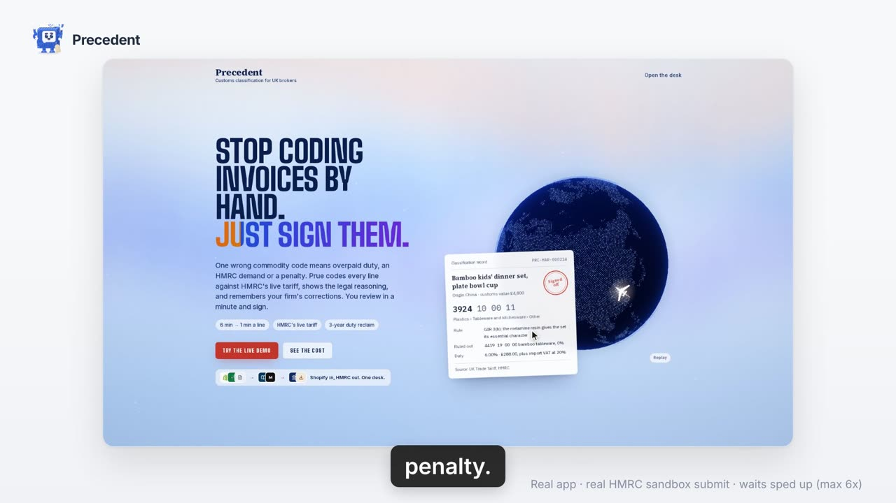
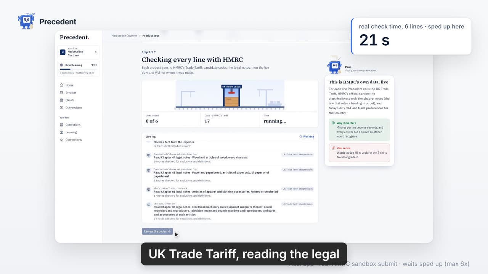
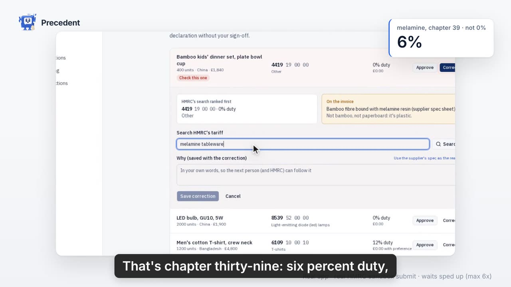
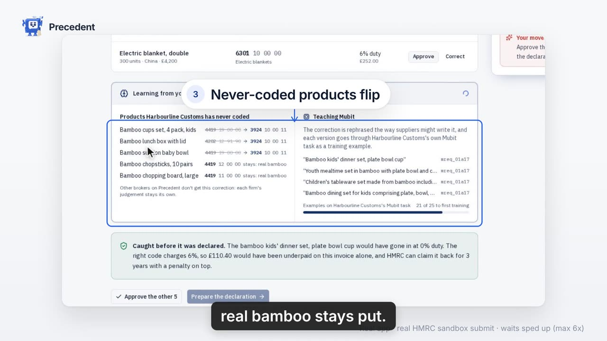
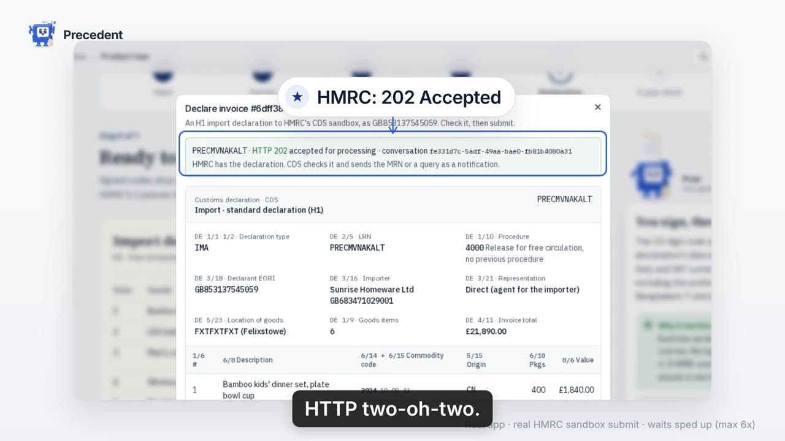
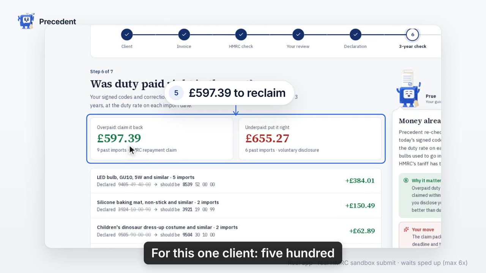
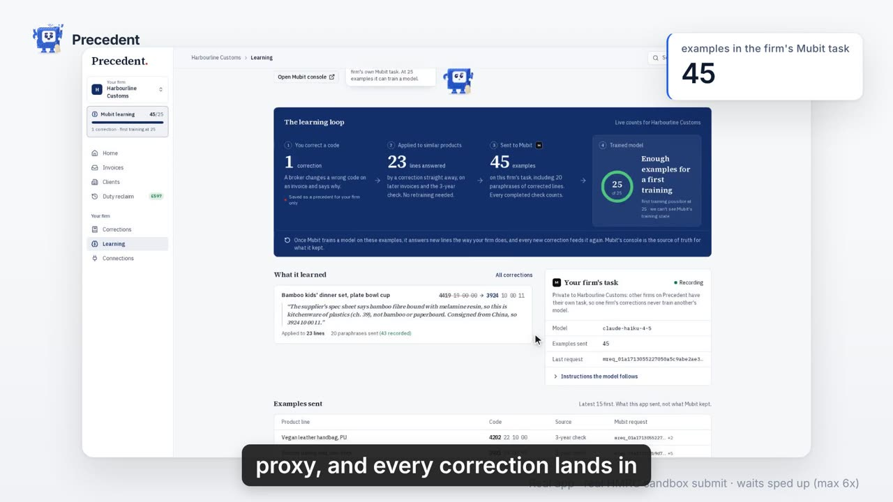

<h1 align="center">Precedent</h1>

<p align="center"><b>Teach a commodity code once. Prue remembers it, for your firm only.</b><br/>
A UK customs desk where an AI agent codes every invoice line against HMRC's live tariff, shows its working, and learns from each broker correction through Mubit.</p>

<p align="center">
  <a href="precedent-launch-A.mp4">Demo video (1:55)</a> ·
  <a href="#how-we-use-mubit">How we use Mubit</a> ·
  <a href="#run-it">Run it locally</a> ·
  <a href="https://github.com/esh1306/mubithack">Repo</a>
</p>

<p align="center">Built for the Mubit × Night Shift hackathon, London, from 23 October 2026. There's no public deployment; it runs locally.</p>

<p align="center">
  
</p>

## Contents

[The problem](#the-problem) · [The demo video](#the-demo-video) · [How we use Mubit](#how-we-use-mubit) · [How it works](#how-it-works) · [Technical details](#technical-details) · [Run it](#run-it) · [Honest notes](#honest-notes) · [Team](#team)

## The problem

UK customs brokers have to give every line on an importer's invoice a 10-digit UK Trade Tariff commodity code. The work is done by hand, and a wrong code is a legal problem for the broker: duty is overpaid or underpaid, HMRC can send a demand, and the broker shares liability as the importer's indirect representative. Precedent is a desk where an AI agent, Prue, codes each line against HMRC's live tariff and shows its working. A broker signs off each line or corrects it, and every correction becomes a precedent that the firm's later invoices follow.

It's for customs brokers and freight forwarders filing UK import declarations. Our working estimate is that coding a line by hand takes about 6 minutes and reviewing Prue's suggestion about 1 (`lib/savings.ts`). On a 40-line invoice that's roughly 4 hours down to 40 minutes. These are estimates, not measured figures.

## The demo video

`precedent-launch-A.mp4` (1:55). The video runs against the real app and makes a real HMRC sandbox submission. Waiting is sped up, at most 6×.

1. **Landing:** "One wrong code. Overpaid duty." This is Precedent.
2. **Desk home:** what Prue has saved the firm (time, £, lines coded), and how she's learning the firm.
3. **Ask Prue:** click the mascot, ask a question, and she answers with the tariff lookups she made.
4. **The tour:** Sunrise Homeware sends a six-line invoice, shipped from Ningbo and Dhaka.
5. **Checking every line with HMRC:** each line goes to the UK Trade Tariff (classification search, chapter notes, commodity lookup), and every code comes with a reason and a source.
6. **A correction:** the bamboo kids' dinner set is bound with melamine resin, so it's chapter 39 plastics at 6% duty, not bamboo at 0%. The broker corrects it and says why.
7. **Precedent and Mubit:** the fix becomes a precedent. About 20 paraphrases are sent through the firm's Mubit task, each with its own request ID. Products the firm has never coded now get the corrected code. Another firm on Precedent doesn't, because the correction belongs to the firm that made it.
8. **Declare:** the broker approves the other five lines and Precedent drafts an H1 import declaration. It's submitted straight to HMRC's CDS sandbox, which returns **HTTP 202 Accepted**.
9. **Look back 3 years:** past imports are re-checked at the duty rate in force on each date. That finds £655.27 of duty to disclose before HMRC finds it, and £597.39 to reclaim.
10. **Learning:** every agent call runs through the firm's own Mubit task. The app's counter showed 45 recorded examples at the time.

<p align="center">
  
  
</p>
<p align="center">
  
  
</p>
<p align="center">
  
  
</p>

<p align="center"><sub>Stills from the demo video, steps 5 to 10.</sub></p>

## How we use Mubit

**Every LLM call goes through Mubit.** The app has one model provider, `lib/mubit.ts`: the Vercel AI SDK's Anthropic client pointed at Mubit's proxy (`https://api.mubit.ai/anthropic/v1`) with `MUBIT_API_KEY`. The model is **`claude-haiku-4-5`**. Calls are made from the server only.

**One Mubit task per firm.** Mubit groups calls into a task by system prompt, model, tools and output format. The classifier's system prompt (`lib/agent.ts`) and its tool definitions are fixed, and only the firm's name changes. So each broker firm gets its own Mubit task, with its own examples and its own adapter. Harbourline's corrections never become Northgate's training data.

**Which calls Mubit records:**

| Call | Where | Recorded by Mubit? |
|---|---|---|
| Classify a line (agent using tools) | `lib/agent.ts` | Yes: this is the firm's task |
| Classify the paraphrases of a correction | `lib/run.ts` → `teachVariants` | Yes: same task |
| Write the paraphrases | `lib/variants.ts` | No (`x-middleware-record: off`) |
| Read a PDF or image invoice | `lib/invoice-file.ts` | No |
| Ask Prue chat | `app/api/prue-chat/route.ts` | No |
| Rewrite helper | `lib/rewrite.ts` | No |

Helper calls opt out of recording, so only real classification work ends up in a firm's training set.

**What happens when a broker corrects a code:**
1. The correction and its reason are saved **in our app** as a `Precedent` row in SQLite. The correction itself isn't sent to Mubit as a label.
2. **Straight away:** on every later line, the agent's first tool call is `search_precedents`. When a precedent applies, the agent follows it and names it. This is how the very next invoice changes, before any training.
3. **For Mubit:** Precedent writes about 20 paraphrases of the corrected line (`VARIANT_COUNT = 20`) and runs each one through the firm's normal classify task. The agent finds the precedent and answers with the corrected code. Mubit records each of those runs as an example, and we store their request IDs (`x-middleware-request-id`) on each suggestion.
4. Once a task has 25 kept examples (`TRAIN_AFTER`), Mubit trains a small adapter on it and tests it against Claude's answers. Mubit only routes traffic to an adapter after it passes those tests.

**Numbers from the Mubit console, last 7 days (25 October 2026):**
- **Requests:** 1,398 through Mubit, with 0 errors and a median response of 1.96 s.
- **Classifier tasks:** Mubit found five "Commodity-code classifier" tasks, all agents making tool calls. There's one task per firm, plus new ones whenever we changed the classifier's prompt or tools during the build. Each change starts a new task, as described above.

  | Task | Calls | Kept examples | Status |
  |---|---|---|---|
  | Commodity-code classifier 2 | 889 | 81 | Adapter testing, v1 |
  | Commodity-code classifier 4 | 255 | 20 of 25 | Reviewing examples |
  | Commodity-code classifier | 153 | 54 | Adapter testing, v2 |
  | Commodity-code classifier 3 | 66 | 36 | Adapter testing, v1 |
  | Commodity-code classifier 5 | 14 | 0 of 25 | Reviewing examples |

- **Adapters trained:** three, all on Qwen3-4B-Instruct-2507. **None has passed its tests yet**, so none is serving.

  | Adapter | Matched Claude's answers | Test cases | Target |
  |---|---|---|---|
  | Classifier 3, v1 | 64.3% | 14 | 85% |
  | Classifier 2, v1 | 57.1% | 14 | 77.9% |
  | Classifier, v2 | 27.8% | 18 | 95% |

- **Routing:** 0% of requests have been routed to an adapter. Every answer in the app and in the video comes from `claude-haiku-4-5` through Mubit's proxy. The learning you see in the demo comes from the precedent loop in steps 1–3, not from an adapter.

**Numbers inside the app:**
- **App database:** the app counts recorded classify calls in its own database: 142 for Harbourline and 14 for Northgate today. The video's "45 examples" is that counter at the time of recording. The Mubit console above is the source of truth.
- **The landing page's "20 of 25" counter** is a scripted animation that explains the idea. It doesn't show live data. The counters in the tour and on the Learning page come from the app's database.

## How it works

- **Classify:** upload an invoice (Excel, CSV, PDF or image), or use a sample. Prue runs per line with tools: `search_precedents`, `hmrc_classification_search`, `read_chapter_notes`, `lookup_commodity` and `ask_client`. She applies HMRC's General Interpretative Rules. Results stream line by line, each with a code, a reason, the rule applied, a confidence and the sources checked.
- **Fix → precedent:** correct a code with a reason, and it applies to similar products for that firm only.
- **Declare:** signed-off lines become an H1 import declaration (WCO DEC-DMS). Preview it, then submit it to HMRC's CDS sandbox or download a CSV.
- **Retro-scan:** re-check 3 years of past entries using today's codes, at historic duty rates. It drafts a reclaim or disclosure pack.
- **Prue:** a draggable mascot that opens a chat. She answers with the same read-only tariff tools and shows each step she took. Drop an invoice on the chat to get its codes back.

| Integration | Status |
|---|---|
| UK Trade Tariff API (HMRC, public) | **Working.** Live search, chapter notes, duty and VAT. A local cache of 1,044 codes is the fallback. |
| HMRC Customs Declarations API (sandbox) | **Working.** OAuth with an HMRC test user. Submitting an H1 declaration returned **202 Accepted** with a conversation ID. Sandbox only. |
| Mubit | **Working.** All model calls, with one task per firm and recorded examples. **Partial:** three adapters are trained but none has passed its tests, so none is serving. |
| Excel / CSV invoice import | **Working.** Columns are detected automatically and totals rows are skipped. |
| PDF / image / text invoices | **Working.** The model reads the lines (not recorded). |
| CSV export for declaration software | **Working.** The code is split into DE 6/14 and 6/15, with an audit log. Live push to ASM, CargoWise or Descartes is **not done**. |
| Shopify | **Partial.** Product CSV import works. Admin API OAuth (import the catalogue, write codes back) is built but wasn't shown in the demo. |

## Technical details

### Architecture

```
 Browser (Next.js client)                 Next.js server (route handlers)                    Outside
 ────────────────────────                 ───────────────────────────────                    ───────
 Desk, Tour, Classify ──SSE stream──▶  /api/[broker]/classify ─▶ lib/agent.ts ──AI SDK──▶  Mubit proxy ─▶ Claude Haiku 4.5
 Prue chat drawer ───────────────────▶  /api/prue-chat (read-only tools)                    (api.mubit.ai/anthropic/v1)
 Fix a code ─────────────────────────▶  /api/[broker]/fix ─▶ Precedent + teachVariants
                                          lib/gov-tariff.ts, lib/tariff-live.ts ─────────▶  UK Trade Tariff API (public)
 Declare ────────────────────────────▶  /api/[broker]/hmrc ─▶ lib/cds.ts ──OAuth 2.0──▶   HMRC CDS sandbox
 Shopify connect / import ───────────▶  /api/[broker]/shopify ─▶ lib/shopify.ts ────────▶  Shopify Admin GraphQL
                                          Prisma 7 ─▶ SQLite (dev.db)
```

Everything runs in one Next.js app. All Mubit, HMRC and Shopify calls are made from the server, so keys never reach the browser.

### Classifying a line

1. **Calling the agent:** `POST /api/[broker]/classify` saves the lines, then classifies 4 at a time and streams each result back as server-sent events (`lib/sse.ts`).
2. **Inside the agent:** `classifyLine` (`lib/agent.ts`) calls `generateText` from the AI SDK with five tools, a 10-step limit, and structured output (`Output.object`, a Zod schema). The output holds the code, reason, GIR rule, note references, rejected codes, confidence, the precedent followed and an optional client question.
3. **The tools:**
   - `search_precedents`: this firm's corrections.
   - `hmrc_classification_search`: HMRC's ranked shortlist.
   - `read_chapter_notes`: legal exclusions and definitions.
   - `lookup_commodity`: whether the code is declarable, its duty, VAT, and any remedy or quota flags.
   - `ask_client`: records the one deciding question for the importer.
4. **Saving:** every tool call, the reasoning and the Mubit request IDs are stored on the `Suggestion`, so the broker sees a receipt for each code.
5. **Fallbacks:**
   - If a call fails, `classifyWithRetry` tries it again, with a back-off between attempts. If every attempt fails, the line is saved as an error.
   - With no Mubit key, `classifyWithoutModel` returns HMRC's top search hit, marked `hmrc-search`, so the desk still works.
6. **Tariff data:** the public trade-tariff endpoints (`www.trade-tariff.service.gov.uk/uk/api/v2`) supply this. Whatever is fetched is cached in the `Tariff` and `Chapter` tables. The retro-scan uses `?as_of=<entry date>` to price past entries at the rate in force on that day.

### Declaring to HMRC

`lib/cds.ts` handles the HMRC sandbox:
- **Sign-in:** an OAuth 2.0 authorisation-code flow against HMRC's sandbox with scope `write:customs-declaration`, with `/api/hmrc/callback` as the redirect.
- **Building the declaration:** a WCO DEC-DMS H1 declaration (XML), built from the signed-off lines. The importer is the client's EORI and the declarant is the signed-in firm.
- **Sending it:** `POST /api/[broker]/hmrc` with `action: "preview"` returns the XML and a summary. `action: "submit"` posts it to the Customs Declarations API and returns the LRN, the HTTP status and the conversation ID.
- **Tokens:** they're stored in the `Credential` table and refreshed automatically.

### Data model (`prisma/schema.prisma`)

| Model | Holds |
|---|---|
| `Broker` | A broker firm: the tenant boundary, and so the Mubit task boundary. |
| `Client` | An importer the firm declares for, with name and EORI. |
| `Line` | An invoice line: text, value, quantity, origin, batch (invoice), source. |
| `Suggestion` | A code for a line: reason, confidence, status (pending, approved, corrected), tool calls, Mubit request IDs, model. |
| `Precedent` | A correction: line text, old code → new code, reason, paraphrases sent and matched, and their request IDs. |
| `Tariff`, `Chapter` | Cached UK Trade Tariff codes with duty rates, and chapter notes. |
| `PastEntry`, `RetroFinding` | Past imports and the over- or under-paid duty found on them, with the calculation. |
| `Credential` | Saved sign-ins for HMRC and Shopify, one per system. |

### API routes (`app/api`)

| Route | What it does |
|---|---|
| `POST [broker]/classify` | Classify lines; results stream back as SSE. |
| `POST [broker]/fix` | Correct a code, which creates a precedent and teaches the paraphrases. |
| `PATCH suggestions/[id]` | Approve or update one suggestion. |
| `GET [broker]/batch` | List invoices, or get one with its lines. |
| `GET [broker]/home`, `learning`, `mubit` | Desk overview, savings, learning stats. |
| `GET, DELETE [broker]/precedents` | List or remove corrections. |
| `GET, POST [broker]/retro-scan` | 3-year duty check. |
| `GET, POST [broker]/hmrc` | HMRC status; preview or submit a declaration. |
| `GET [broker]/export` | Declaration CSV (DE 6/14, 6/15), or `&audit=1` for the evidence file. |
| `[broker]/shopify`, `[broker]/clients/...` | Shopify import and write-back; importers. |
| `POST parse-invoice` | Read an uploaded invoice into lines. |
| `POST prue-chat` | Prue's chat, using read-only tools. |
| `tariff/*` | Tariff search, candidates, a single code, cache status. |
| `POST demo/reset` | Reset the demo data. |

### Project layout

```
app/
  page.tsx, how-it-works/     public landing page and explainer
  start/                      choose a firm
  [broker]/                   the desk: home, classify, clients, precedents, retro-scan,
                              export, integrations, mubit (learning), tour
  api/                        route handlers (above)
components/                   UI: Prue (prue.tsx, generated), prue-guide/prue-chat, declare-button,
                              landing-*, sidebar, shadcn/ui primitives in ui/
lib/                          agent, mubit, run (classify, retry, teach), gov-tariff, tariff-live,
                              cds, shopify, invoice-file, duty, savings, variants, claim-pack
mascot/                       Prue's source (core.ts); `node mascot/build.mjs` writes components/prue.tsx
prisma/                       schema and migrations
scripts/                      seed, smoke test, warm-up, tariff pull, tricky-item tests
data/samples/                 sample invoices (CSV, XLSX, Shopify CSV)
docs/                         HMRC.md, SHOPIFY.md, DEMO.md, PLAN.md, tricky-items.md
```

### Scripts

Scripts run on Node through `bun run script scripts/<name>.mts`, because better-sqlite3 doesn't load under Bun.

| Command | What it does |
|---|---|
| `bun run seed` | Firms, tariff cache, chapter notes, past entries. |
| `bun run smoke` | No-key checks: tariff search, duty maths, paraphrases, the missing-key message. |
| `bun run demo` | Production build and start, for recording demos. |
| `scripts/ping-mubit.mts` | One test call through Mubit. |
| `scripts/warm-up.mts [broker]` | Send every sample line through a firm's Mubit task, adding more examples. |
| `scripts/train-adapter.mts [broker]` | Send the 153 varied lines in `data/training/lines.csv` through a firm's classify task, as more adapter training examples. They go to a hidden `training` batch, and re-running resumes. |
| `scripts/test-tricky.mts` | Run the tricky items in `docs/tricky-items.md` through the agent. |
| `scripts/pull-tariff.mts` | Re-pull the tariff cache from the UK Trade Tariff API. |

## Run it

Needs [Bun](https://bun.sh) and Node 20+.

```bash
bun install
cp .env.example .env.local   # then fill in the keys below
cp .env.example .env         # DATABASE_URL for Prisma
bunx prisma migrate dev      # creates dev.db
bun run seed                 # firms, tariff cache, chapter notes, past entries
bun run dev                  # http://localhost:3000
```

| Variable | Needed for |
|---|---|
| `DATABASE_URL` | SQLite, `file:./dev.db` |
| `MUBIT_API_KEY` | All model calls (from app.mubit.ai). Without it, Classify falls back to HMRC's search alone. |
| `HMRC_CLIENT_ID`, `HMRC_CLIENT_SECRET` | Optional. CDS sandbox submission; see `docs/HMRC.md`. Register the redirect URI for `http://localhost:3000`. |
| `SHOPIFY_CLIENT_ID`, `SHOPIFY_CLIENT_SECRET` | Optional. Shopify OAuth; see `docs/SHOPIFY.md`. |

**Demo data:**
- **Firms:** two seeded broker firms, `harbourline` and `northgate`.
- **Tour:** `/harbourline/tour` uses the Sunrise Homeware invoice, which includes the bamboo kids' dinner set.
- **Samples:** sample invoices are in `data/samples/`, including `pearl-river-commercial-invoice.xlsx` and a Shopify product CSV.
- **Retro-scan:** the 40 past entries it re-checks are seeded demo data.
- **HMRC test user:** you create one in the HMRC Developer Hub sandbox; none is checked in.

## Fresh code and open source

All code was written during the hackathon, starting 23 October 2026.

Main open-source libraries:
- **App:** Next.js, React, TypeScript, Tailwind CSS, shadcn/ui and Radix UI.
- **Model calls:** Vercel AI SDK (`ai`, `@ai-sdk/anthropic`).
- **Data:** Prisma with better-sqlite3, Zod and ExcelJS.
- **Landing page:** GSAP, three.js, globe.gl and react-globe.gl, d3-geo, topojson-client, world-atlas and Lenis.
- **UI extras:** lucide-react, cmdk and Sonner.

## Troubleshooting

- **"Mubit API key is missing"**
  - Set `MUBIT_API_KEY` in `.env.local` and restart `bun run dev`.
  - Haiku 4.5 runs on Mubit's starter credit only while no Anthropic key is saved under Provider keys in Mubit.
- **HMRC sign-in or submission fails**
  - The HMRC Developer Hub app must be subscribed to Customs Declarations.
  - The redirect URI must match `http://localhost:3000/api/hmrc/callback`.
  - The test user needs the `customs-services` service. See `docs/HMRC.md`.
- **Types missing from Prisma after a pull:** run `bunx prisma generate`.
- **The sidebar or styles look stale after a pull:** hard-refresh the page. Turbopack sometimes misses a CSS change.
- **Changing the classifier's system prompt or tools starts a new Mubit task**, which resets the example count. Keep `systemPrompt()` and `readTools()` in `lib/agent.ts` stable.

## Honest notes

- **No adapter is serving yet.** Three are trained, none has passed Mubit's tests, and 0% of requests are routed to one. The learning in the demo comes from the precedent loop.
- **Time savings are estimates** (`lib/savings.ts`), not measurements.
- **HMRC submission is sandbox only**, with an HMRC test user.
- **The landing page's "20 of 25" counter is a scripted animation**, not live data.
- **Not done:** live push to ASM, CargoWise or Descartes. Shopify OAuth is built but wasn't shown in the demo.
- **Retro-scan data is seeded** demo data (40 past entries).

## Team

- Sahid Munjavar ([Sahid-m](https://github.com/Sahid-m))
- Eshita Agarwal ([esh1306](https://github.com/esh1306))

## License

No license has been chosen yet. All rights reserved by the authors until one is added.
